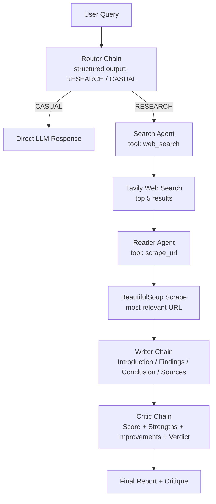
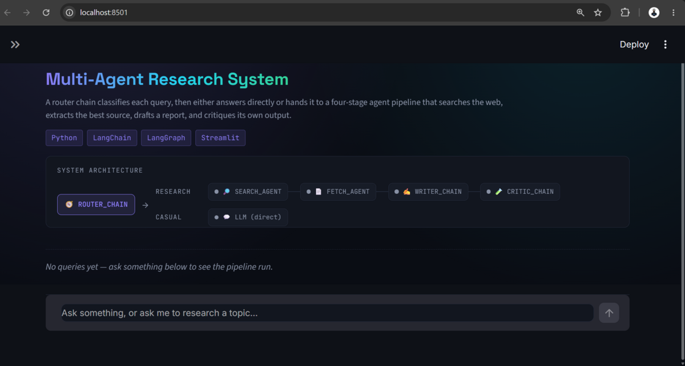
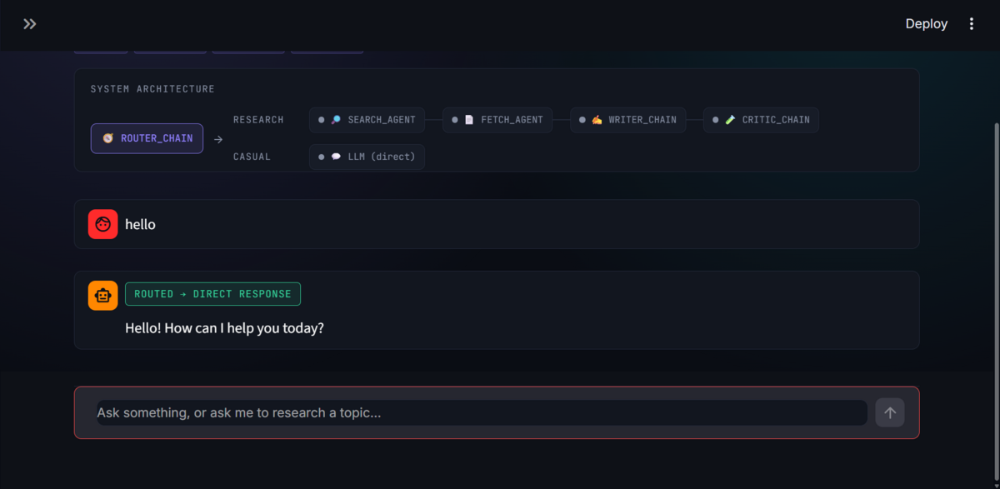
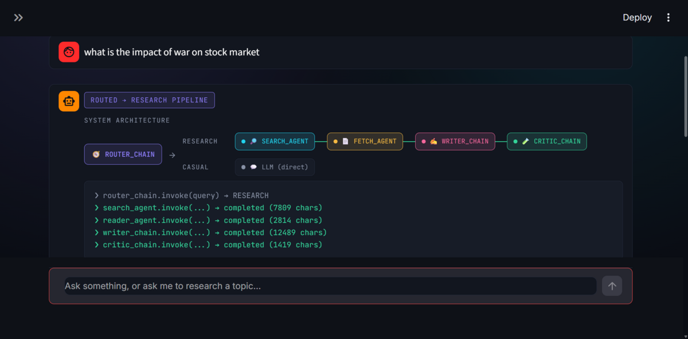
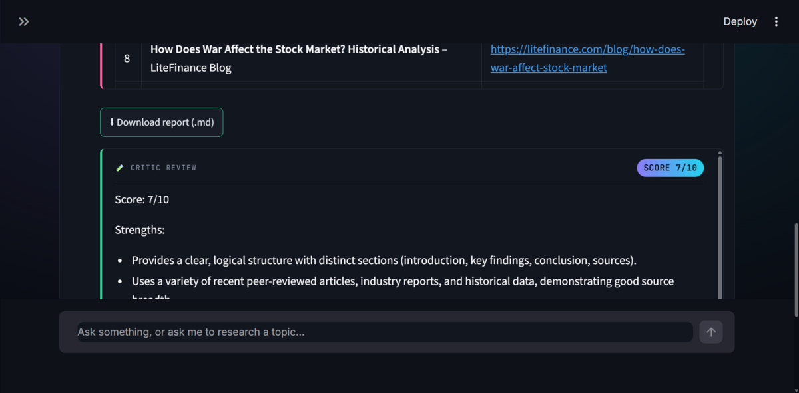
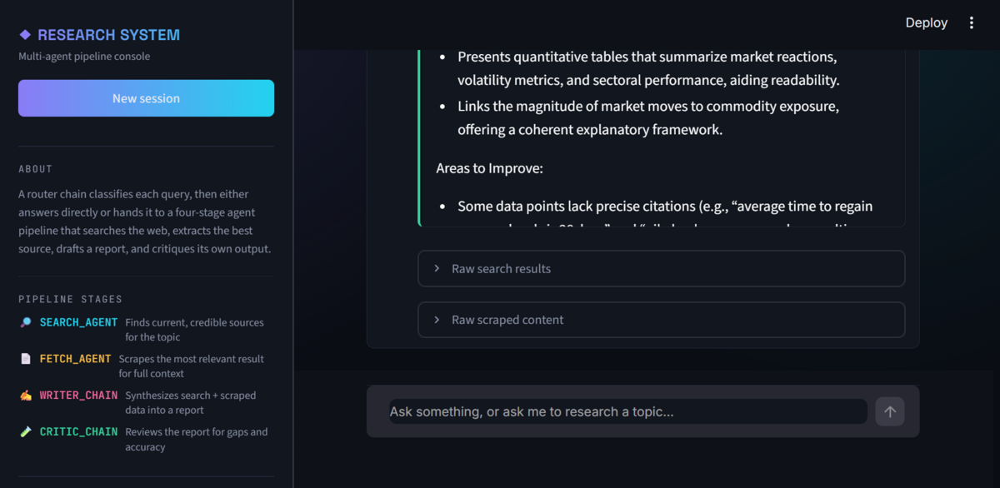

# Multi-Agent AI Research Assistant


> An agentic AI system that routes each user query to either a direct conversational response or a four-stage autonomous research pipeline — searching the web, scraping the most relevant source, drafting a structured report, and independently critiquing that report's quality.

---

## 1. Project Overview

Most "AI research assistants" are a single prompt wrapped around a search API. This project instead splits the job across **specialized agents and chains**, each with a narrow responsibility and a restricted toolset:

- A **router** decides, per query, whether the request needs research at all.
- A **search agent** is only allowed to call a web search tool — it cannot open URLs.
- A **reader agent** is only allowed to call a scraping tool — it cannot search.
- A **writer chain** turns the gathered evidence into a structured report.
- A **critic chain** independently scores that report instead of trusting it blindly.

This avoids the two common failure modes of naive chatbot-style research tools: doing expensive web research for a simple "hello", and treating the first LLM draft as the final answer with no quality check.

The project ships with two interchangeable entry points that hit the same underlying agents and chains: a plain CLI (`pipeline.py`) and a Streamlit dashboard (`app.py`) that visualizes the pipeline running live.

---

## 2. Key Features

- **Structured-output query routing** — an LLM call constrained to a `Literal["RESEARCH", "CASUAL"]` Pydantic schema, so routing can't return free-form or malformed text.
- **Tool-restricted agents** — the search agent only has access to `web_search`; the reader agent only has access to `scrape_url`. Neither can perform the other's job.
- **Live web search** via the Tavily API, returning titles, URLs, and content snippets.
- **Web scraping** via `requests` + `BeautifulSoup` (lxml parser), with script/style/nav/footer tags stripped before text extraction.
- **Structured report generation** — Introduction, Key Findings, Conclusion, and Sources, generated from the combined search + scraped evidence.
- **Independent report critique** — a separate chain scores the report out of 10 across accuracy, relevance, completeness, clarity, structure, reasoning, and source usage.
- **Two runnable interfaces**: a terminal chat loop (`pipeline.py`) and a full Streamlit dashboard (`app.py`).
- **Live pipeline visualization** in the Streamlit UI — an animated architecture diagram that highlights the active stage, a timestamped execution log, a route badge (RESEARCH / CASUAL / UNKNOWN), and per-session chat history.
- **Graceful degradation** — every pipeline stage is wrapped in `try/except`; a failure at one stage (e.g. scraping blocked) surfaces as an error string in that stage's output rather than crashing the run.
- **Downloadable output** — the Streamlit UI lets you export the generated report as a `.md` file directly from the browser.

---

## 3. System Architecture



---

## 4. How It Works

### Step 1 — Query Routing
`router_chain` (`agents.py`) sends the raw user query to a Groq-hosted LLM with `.with_structured_output(RouteDecision)`, where `RouteDecision` is a Pydantic model with a single field: `category: Literal["RESEARCH", "CASUAL"]`. This forces the model to return one of exactly two values instead of free text — no regex or string-matching needed to parse the route.

### Step 2 — Search Agent
If the route is `RESEARCH`, `build_search_agent()` constructs a LangChain agent (`create_agent`) whose only tool is `web_search`. Its system prompt explicitly forbids it from opening or scraping URLs — its sole job is to query Tavily and return titles, URLs, and snippets for up to 5 results.

### Step 3 — Reader Agent
`build_fetch_agent()` constructs a second agent whose only tool is `scrape_url`. It receives the search agent's output (truncated to 3000 characters), picks the single most relevant URL, and scrapes it with `requests` + `BeautifulSoup`. The scraper strips `<script>`, `<style>`, `<nav>`, and `<footer>` tags and returns up to 3000 characters of clean text.

### Step 4 — Writer
`writer_chain` combines the raw search results and the scraped content into one prompt and asks the LLM to produce a report with four fixed sections: **Introduction**, **Key Findings** (minimum 3 points), **Conclusion**, and **Sources**.

### Step 5 — Critic
`critic_chain` receives only the finished report (not the raw research) and evaluates it independently on accuracy, relevance, completeness, clarity, structure, reasoning, and source usage. It returns a fixed-format response: a `Score: X/10`, a bullet list of strengths, a bullet list of areas to improve, and a one-sentence verdict. The critic does not rewrite the report.

---

## 5. Technology Stack

| Technology | Purpose |
|---|---|
| Python | Core application language |
| LangChain (`langchain`, `langchain-core`, `langchain-community`) | Agent construction (`create_agent`), prompt templates, chain composition |
| `langchain-groq` / `groq` | LLM inference (`ChatGroq`, model `openai/gpt-oss-120b`) |
| Tavily (`tavily-python`, `langchain-tavily`) | Web search API |
| BeautifulSoup4 + lxml | HTML parsing and text extraction |
| Requests | HTTP calls for scraping |
| Pydantic | Structured output schema for the router (`RouteDecision`) |
| Streamlit | Interactive web dashboard (`app.py`) |
| python-dotenv | Loading API keys from `.env` |
| `langgraph` / `langgraph-prebuilt` | Backing runtime for `langchain.agents.create_agent` |

> `requirements.txt` also lists `httpx`, `aiohttp`, and `pypdf` for future/optional use — they are not exercised by the current code paths.

---

## 6. Project Structure

```text
multi-agent-research-assistant/
│
├── app.py              # Streamlit dashboard — live pipeline visualization, chat UI, report/critique cards
├── agents.py            # LLM client, router chain, search/reader agent builders, writer & critic chains
├── pipeline.py           # CLI entry point — terminal chat loop, same routing/pipeline logic
├── tools.py             # LangChain tools: web_search (Tavily), scrape_url (requests + BeautifulSoup)
├── requirements.txt
└── README.md
```

*(No `.env.example`, license file, or `assets/` folder currently exist in the project — see the checklist at the end of this README.)*

---

## 7. Installation

### Clone the repository

```bash
git clone YOUR_REPOSITORY_URL
cd multi-agent-research-assistant
```

### Create a virtual environment

**Windows**
```bash
python -m venv .venv
.venv\Scripts\activate
```

**Linux / macOS**
```bash
python -m venv .venv
source .venv/bin/activate
```

### Install dependencies

```bash
pip install -r requirements.txt
```

---

## 8. Environment Variables

Create a `.env` file in the project root:

```env
GROQ_API_KEY=your_groq_api_key
TAVILY_API_KEY=your_tavily_api_key
```

- `GROQ_API_KEY` — used by `ChatGroq` in `agents.py` for all routing, agent, writer, and critic calls.
- `TAVILY_API_KEY` — used by `TavilyClient` in `tools.py` for web search.

> **Never commit your `.env` file or API keys to GitHub.** Add `.env` to your `.gitignore`.

---

## 9. Running the Project

**CLI version:**
```bash
python pipeline.py
```
Runs a terminal chat loop. Type a query, view the routed response, and type `exit` or `quit` to stop.

**Streamlit dashboard (recommended):**
```bash
streamlit run app.py
```
Opens a browser-based dashboard with a live architecture diagram, execution log, chat interface, and downloadable reports.

---

## 10. Example Usage

### Casual query
```text
User: hello

Router: CASUAL
Assistant: Hello! How can I help you?
```

### Research query
```text
User: Research the latest developments in artificial intelligence.

Router: RESEARCH
  → Search Agent (Tavily, 5 results)
  → Reader Agent (scrapes the most relevant URL)
  → Writer Chain (Introduction / Key Findings / Conclusion / Sources)
  → Critic Chain (Score + Strengths + Areas to Improve + Verdict)
```

---

## 11. Sample Output

### Dashboard — first look
Header, tech badges, and the static system architecture diagram before any query is asked.



### Casual query — direct response
A greeting is routed straight to the LLM, skipping the research pipeline entirely.



### Research query — live pipeline run
A research query in progress: the architecture diagram highlights each completed stage, and the execution log shows real invocation output sizes for the search, reader, writer, and critic steps.



### Generated report + critic review
The finished report with its source list, a download button, and the critic's score, strengths, and areas to improve.



### Sidebar — pipeline stages and raw data
The sidebar's pipeline-stage descriptions, plus the expandable "Raw search results" / "Raw scraped content" panels.



---

## 12. Why Multi-Agent?

- **Separation of responsibilities** — the search agent finds sources; the reader agent reads them. Neither can do the other's job, which is enforced at the tool level, not just by prompting.
- **Independent evaluation** — the critic sees only the finished report, not the research process, so its score isn't biased by how the report was produced.
- **Modularity** — each stage (router, search, reader, writer, critic) is a separate function/chain in `agents.py`, so any one of them can be swapped, upgraded, or tested in isolation.
- **Cost control** — the router prevents a full 4-stage pipeline (search → scrape → write → critique) from running on a simple greeting.

---

## 13. Design Decisions

**Why a router?**
To avoid triggering an expensive multi-agent pipeline for conversational queries that don't need research.

**Why separate search and reader agents instead of one agent with both tools?**
Giving one agent both `web_search` and `scrape_url` risks it skipping search entirely or scraping arbitrary URLs. Restricting each agent to a single tool, enforced via its system prompt and tool list, keeps the workflow predictable.

**Why a structured-output router instead of parsing free text?**
`RouteDecision` (a Pydantic model) forces the LLM to return one of exactly `RESEARCH` or `CASUAL`, removing the need for string matching or handling malformed categories.

**Why an independent critic instead of trusting the writer's output?**
The critic evaluates the finished report from scratch and is explicitly instructed not to rewrite it — it's a check on quality, not a second draft.

---

## 14. Limitations

- The reader agent scrapes only **one** URL per query — it does not cross-check multiple sources.
- Scraped content is truncated to 3,000 characters, so long articles are only partially read.
- The scraper (`requests` + `BeautifulSoup`) cannot render JavaScript-heavy pages.
- Some sites block scraping outright (returned as an error string, not a crash).
- Search is capped at 5 results per query (Tavily `max_results=5`).
- Report quality depends entirely on the quality of the single scraped source.
- All stages (router, search, writer, critic) use the same LLM (`openai/gpt-oss-120b` via Groq) — there's no per-task model selection.
- The critic's score is generated by the same class of LLM producing the report, so it isn't a fully independent (e.g. human or rule-based) evaluation.
- In the Streamlit UI, chat history lives only in `st.session_state` — it is not persisted to disk and is lost on a full app restart.

---

## 15. Future Improvements

*The following are not implemented — they are proposed directions:*

- Scrape and cross-reference multiple sources instead of one.
- Persist conversation history across sessions (currently in-memory only).
- Parallelize search and scraping for faster responses.
- Add a critic → writer refinement loop instead of a single terminal critique.
- Stronger citation tracking tied to specific claims, not just a URL dump.
- Explicit LangGraph state-graph orchestration instead of sequential function calls with try/except.
- JavaScript rendering support (e.g. Playwright) for dynamic pages.
- Per-task model selection (a smaller/cheaper model for routing vs. writing).
- Docker and cloud deployment configuration.
- Source credibility scoring.
- Automated tests and evaluation benchmarks.

---

## 16. Technical Concepts Demonstrated

- Agentic AI with tool-restricted, single-responsibility agents
- LLM orchestration and chain composition with LangChain
- Structured outputs via Pydantic (`with_structured_output`)
- Tool calling (`web_search`, `scrape_url`)
- Prompt engineering (system prompts constraining agent behavior)
- Web search API integration (Tavily)
- Web scraping and HTML text extraction (BeautifulSoup)
- Multi-stage pipeline design with per-stage error handling
- Building a real-time UI on top of a multi-step agent pipeline (Streamlit)

---

## Resume-Ready Description

- Built a multi-agent AI research assistant in Python using LangChain and Groq-hosted LLMs, with a structured-output router that classifies queries as conversational or research-driven before invoking a four-stage agent pipeline.
- Designed tool-restricted agents — a search agent (Tavily API) and a reader agent (BeautifulSoup scraping) — enforcing separation of concerns between source discovery and content extraction.
- Implemented an independent critic chain that scores generated reports across seven quality dimensions, and built a live Streamlit dashboard visualizing each pipeline stage in real time.

---

## Interview Talking Points

1. **Why multi-agent instead of one large prompt?** Separation of concerns — each agent/chain has one job and a restricted toolset, which makes behavior more predictable and each stage independently testable.
2. **Why LangChain's `create_agent`?** It provides a ready-made agent loop (tool selection + invocation) without hand-rolling the ReAct/tool-calling loop myself.
3. **Why Tavily over a raw search API?** It returns clean, LLM-friendly results (title/URL/snippet) in one call, rather than raw HTML search results.
4. **How does routing work?** A Pydantic model (`RouteDecision`) constrains the LLM's output to `RESEARCH` or `CASUAL` via `with_structured_output`, avoiding free-text parsing.
5. **How does tool calling work here?** Each agent is built with exactly one tool in its tool list and a system prompt reinforcing that restriction, so the model can't call a tool it wasn't given.
6. **How does scraping work, and what happens when it fails?** `requests.get()` with a browser User-Agent, parsed with BeautifulSoup/lxml, stripping non-content tags. Failures are caught and returned as an error string so the pipeline continues instead of crashing.
7. **How is state passed between stages?** A plain Python `dict` (`state`) accumulates each stage's output (`search_results`, `scraped_content`, `report`, `critic_report`) and is passed forward explicitly — no shared global state.
8. **Why separate the writer and critic?** The critic evaluates the finished report from a fresh perspective and is explicitly told not to rewrite it, so it functions as a check rather than a second draft.
9. **What are the current limitations?** Single-source scraping, 3,000-character truncation, no JS rendering, and no persistent history — all listed transparently in the README.
10. **What would you improve first?** Multi-source scraping and a critic → writer refinement loop, since those most directly affect report quality.

---

## Missing Assets / Information to Add

Before publishing, you should provide:

- [ ] **GitHub repository URL** — currently a placeholder (`YOUR_REPOSITORY_URL`)
- [x] **Screenshots** of the Streamlit dashboard — added to Section 11 (`assets/`)
- [ ] **Demo URL** (if deployed anywhere)
- [ ] **License choice** — no license file currently exists in the project
- [x] **`.env.example`** — added to the repo